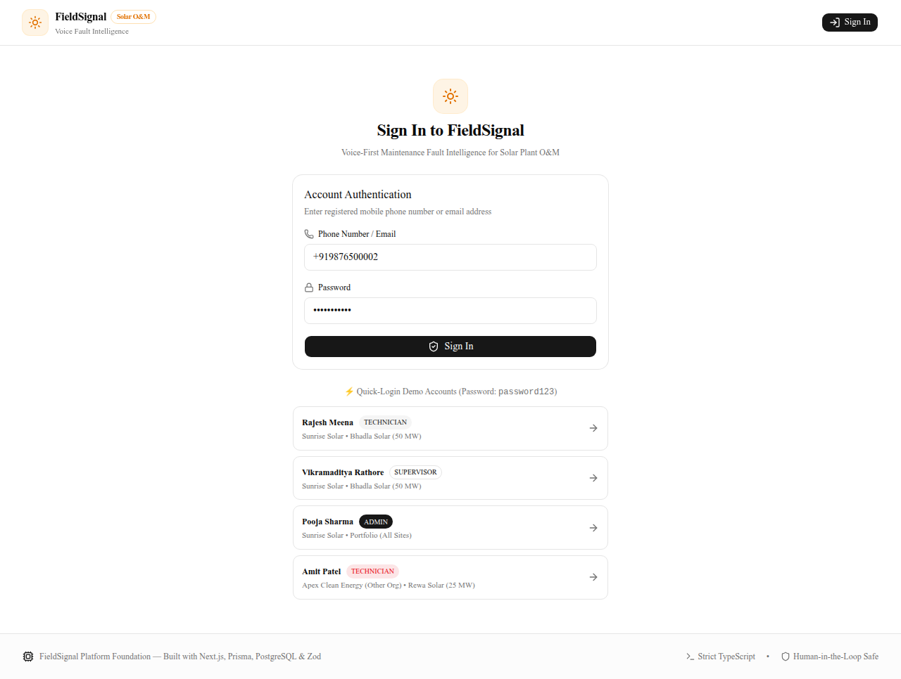
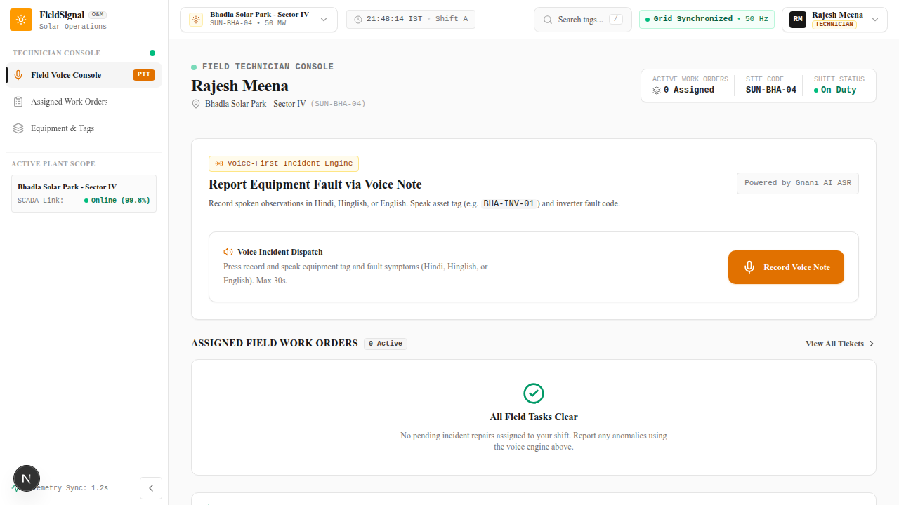
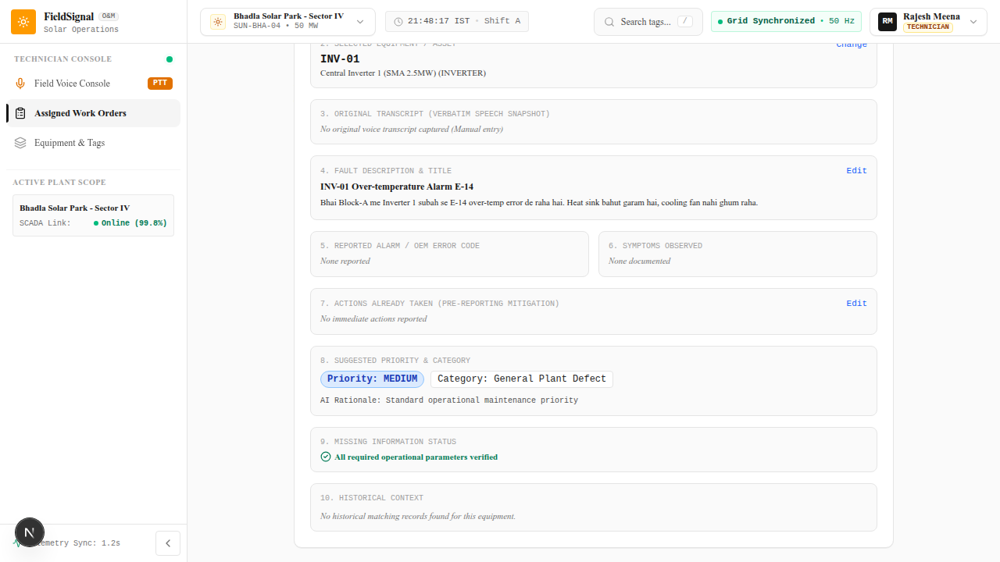
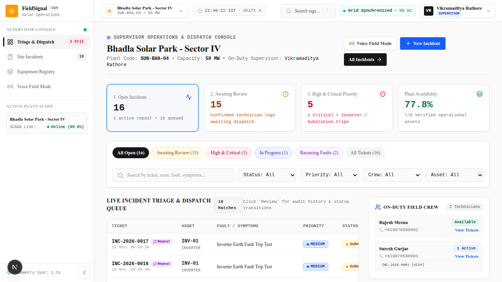
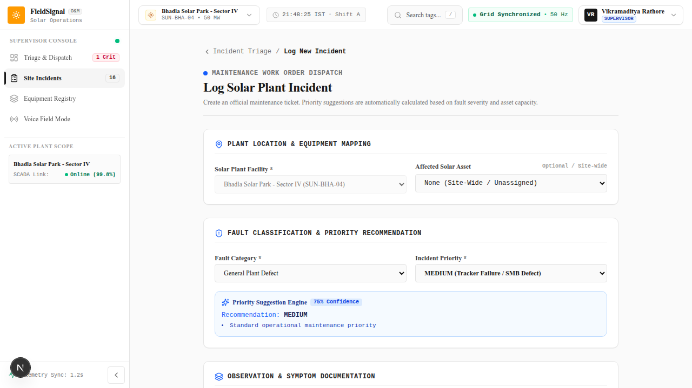
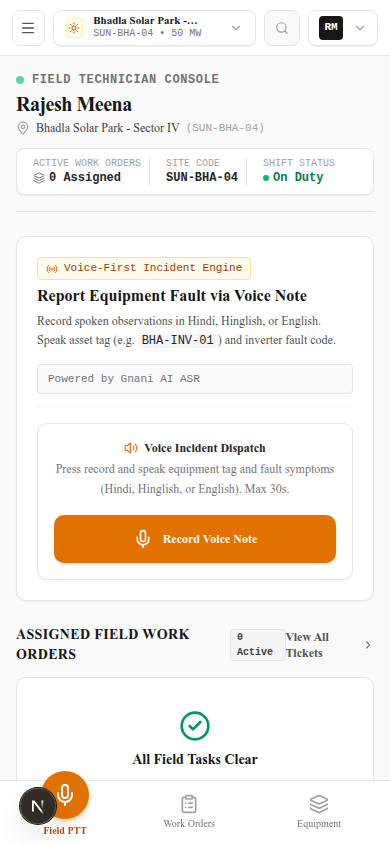
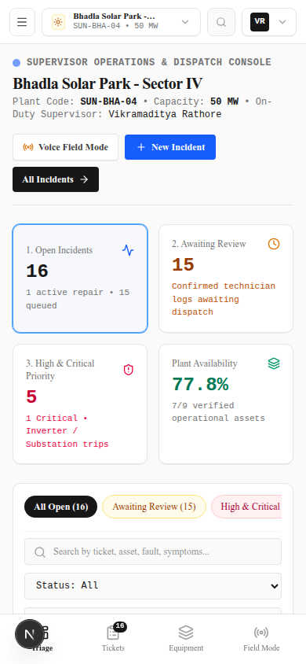

# FieldSignal — Voice-First Solar O&M Maintenance Intelligence

[](https://www.typescriptlang.org/)
[](https://nextjs.org/)
[](https://react.dev/)
[](https://www.prisma.io/)
[](https://tailwindcss.com/)
[](docs/TEST_RESULTS.md)

FieldSignal is a voice-first, AI-driven maintenance fault reporting and operations dispatch platform engineered specifically for utility-scale solar photovoltaic (PV) operations and maintenance (O&M). 

Field technicians working under harsh desert sunlight in remote solar parks can press a single button, speak equipment anomalies naturally in **Hindi, Indian English, or Hinglish**, and have their speech transcribed, normalized, cross-referenced with asset hierarchies, checked against historical records, and structured into verified maintenance tickets with an immutable audit trail.

---

## 📸 Product Walkthrough

### 1. Account Authentication & Demo Fast-Login
Accessible login screen with role-based fast authentication cards for competition demonstration.


### 2. Voice Field Console
Single-tap audio recording with live waveform feedback, multilingual detection (Hindi, Hinglish, English), and fallback simulation chips.


### 3. Technician Review & Confirmation Screen
Mandatory human-in-the-loop review showing the 10 mandated parameters, extracted fields, detected alarms, historical context, and explicit confirmation checkbox.


### 4. Supervisor Operations Dispatch Dashboard
Real-time plant dispatch console with live KPI metrics, crew workload roster, recurring asset frequency, and incident triage table—all computed strictly from database records.


### 5. Incident Detail & Immutable Audit Timeline
Comprehensive ticket view featuring full lifecycle status controls, Gnani AI Timbre spoken audio updates, historical incident intelligence, and an immutable event audit trail.


### 6. Mobile Field Experience
Optimized for smartphones and rugged field tablets under direct desert sunlight with high-contrast UI and touch targets.
| Mobile Field Console | Mobile Supervisor Dashboard |
| :---: | :---: |
|  |  |

---

## ⚡ Core Capabilities Verified Against PRD

| PRD Requirement | Implementation Mechanism | Verification Proof |
| :--- | :--- | :--- |
| **Gnani AI ASR Integration** | Server-side integration with Gnani AI Vachana REST API v3 (`https://api.vachana.ai/stt/v3`) using `prisma-v3.0` multilingual model. | Genuine API integration in `src/modules/speech/gnani-speech-service.ts`. |
| **Gnani AI Timbre TTS Integration** | Server-side speech synthesis using Timbre REST API v3.0 (`timbre-v3.0`), configurable voices (`Shivani`, `Avinash`), and non-blocking playback. | `scripts/test-gnani-timbre-tts.ts` passes; app remains fully functional without TTS. |
| **Real Audio Ingestion** | Web Audio API / MediaRecorder capturing Opus/WebM and WAV buffers with server-side validation and transcoding. | `src/app/api/v1/speech/transcribe/route.ts` validates payloads and hashes audio buffers. |
| **Verbatim Transcript Preservation** | Original speech transcript is permanently preserved in a dedicated database column separate from edited fields. | Verified in `scripts/test-asset-incident-validation.ts`. |
| **Deterministic Asset Matching** | Plant-scoped matching against database assets by tag (`INV-01`), normalized spacing, and hierarchical type compatibility. | Rejects unknown tags (`NO_MATCH`), flags cross-site codes (`SITE_MISMATCH`). |
| **Ambiguity & Clarification Flow** | Multi-turn conversational flow asking **one focused question at a time**, advancing without repeating resolved fields. | `scripts/test-clarification-workflow.ts` (61 passed). |
| **Historical Incident Intelligence** | Retrieves past 30-day incidents on the asset, computes symptom Jaccard similarity, displays past actions, and flags repeat faults. | **Negative invariant enforced:** Never claims identical root cause merely due to description similarity. |
| **Explicit Confirmation Guard** | Requires explicit technician confirmation (`isConfirmed: true`) before ticket creation; rejects premature submissions with HTTP 422. | `scripts/test-technician-confirmation-workflow.ts`. |
| **Idempotent Incident Creation** | Concurrency guard prevents duplicate incidents on network retries by checking matching asset, site, and reporter within 15 minutes. | Duplicate submissions return existing ticket without duplication. |
| **Supervisor Dispatch Dashboard** | Live operational metrics computed strictly from active PostgreSQL records (zero fake statistics). | Verified by `scripts/test-supervisor-dashboard.ts`. |
| **Immutable Audit History** | `IncidentEvent` table logs all state changes, assignments, field edits, and confirmations with user stamps. | Immutable timeline displayed on `/incidents/:id`. |

---

## 🏗️ Architecture & Technology Stack

```
┌────────────────────────────────────────────────────────────────────────┐
│                        FIELD CLIENTS (PWA / Mobile / Tablet)           │
│   • Voice Field Console (Web Audio API / MediaRecorder)                │
│   • Supervisor Operations Dispatch Dashboard                           │
│   • Asset & Incident Explorer                                          │
└───────────────────────────────────┬────────────────────────────────────┘
                                    │ HTTPS (TLS 1.3 + HSTS)
                                    ▼
┌────────────────────────────────────────────────────────────────────────┐
│                   NEXT.JS 16 APP ROUTER (TURBOPACK)                    │
│   • React 19 Server Components + Client Islands                        │
│   • Route Handlers (/api/v1/*) with Multi-Tenant RBAC Guards           │
│   • Ephemeral Audio Storage (/tmp/fieldsignal-audio)                   │
│   • Zero-Dependency Structured JSON Production Logger                  │
│   • Active Health Telemetry Probe (/api/v1/health)                     │
└───────────────┬───────────────────────────────┬────────────────────────┘
                │                               │
    Pooled PgBouncer (Port 6543)                │ REST API (HTTPS)
                │                               │
                ▼                               ▼
┌─────────────────────────────────┐   ┌──────────────────────────────────┐
│   POSTGRESQL DATABASE CLUSTER   │   │      EXTERNAL AI INTEGRATIONS    │
│   • 7 Relations with UUID PKs   │   │   • Gnani AI Vachana ASR v3      │
│   • ACID Idempotency Guard      │   │   • Gnani AI Timbre TTS v3.0     │
│   • Immutable Audit Event Log   │   │   • Google Gemini 1.5 Flash      │
└─────────────────────────────────┘   └──────────────────────────────────┘
```

- **Framework**: Next.js 16.4.4 (App Router, Turbopack)
- **UI & Styling**: React 19.3.0, Tailwind CSS v4, Lucide Icons, Shadcn primitives
- **ORM & Database**: Prisma 6.19.3, PostgreSQL 15+ (with connection pooler & direct URL support)
- **Speech Recognition (ASR)**: Gnani AI Vachana REST API v3 (`prisma-v3.0`)
- **Text-to-Speech (TTS)**: Gnani AI Timbre REST API v3.0 (`timbre-v3.0`)
- **AI Extraction**: Google Gemini 1.5 Flash (via `@google/genai` or OpenAI-compatible format)
- **Testing**: Vitest 5.1.0 (Unit Suite), Playwright 1.65.0 (E2E Suite), TSX Integration Suites

---

## 🚀 Quick Start Guide

### 1. Prerequisites
- **Node.js**: v20.x or higher
- **PostgreSQL**: v15.x or higher
- **npm**: v10.x or higher

### 2. Installation & Configuration
```bash
# Clone the repository
git clone https://github.com/karansaini46/FieldSignal.git
cd FieldSignal

# Install dependencies
npm install

# Configure environment variables
cp .env.example .env
```

Edit `.env` to supply your PostgreSQL database credentials and Gnani AI / Gemini API keys. (See [docs/SETUP.md](docs/SETUP.md) for full configuration options).

### 3. Database Migration & Synthetic Seed Data
```bash
# Apply schema migrations to your database
npm run db:migrate:prod

# Seed synthetic solar park demonstration data
npm run db:seed
```

### 4. Run Development Server
```bash
npm run dev
```
Open [http://localhost:3000](http://localhost:3000) in your browser.

---

## 👥 Demo User Accounts (Synthetic Seed Data)

All passwords in local development and demonstration are: `password123`

| Name | Role | Mobile Identifier | Assigned Solar Site |
| :--- | :--- | :--- | :--- |
| **Rajesh Meena** | `TECHNICIAN` | `+919876500002` | Bhadla Solar Park (50 MW Sector IV) |
| **Vikramaditya Rathore** | `SUPERVISOR` | `+919876500001` | Bhadla Solar Park (50 MW Sector IV) |
| **Pooja Sharma** | `ADMIN` | `+919876500000` | Enterprise Portfolio (Sunrise Solar) |
| **Amit Patel** | `TECHNICIAN` | `+919876599999` | Pavagada Solar Park (Apex Clean Energy - Other Org) |

---

## 🧪 Comprehensive Verification & Test Suite

FieldSignal includes an exhaustive automated test suite covering unit tests, end-to-end browser tests, and 7 domain-specific integration suites:

```bash
# Run Vitest unit tests (40/40 passing)
npm run test:unit

# Run Playwright end-to-end browser tests (12/12 passing)
npm run test:e2e

# Run domain integration test suites
npm run test:auth          # 18/18 Authentication & Multi-Tenant Isolation
npm run test:validation    # 65/65 Asset Matching & Incident Validation
npm run test:clarification # 61/61 Multi-Turn Clarification Workflow
npm run test:historical   # Historical Intelligence & Negative Invariant
npm run test:confirmation # Technician Review, Confirmation & Idempotency
npm run test:supervisor   # Supervisor Operations Dashboard & Real Queries
npm run test:tts          # Gnani AI Timbre TTS Server Integration
```

Detailed test logs and audit methodology are documented in [docs/TEST_RESULTS.md](docs/TEST_RESULTS.md).

---

## 📚 Documentation Index

- **[docs/SETUP.md](docs/SETUP.md)**: Developer onboarding and environment configuration.
- **[docs/ARCHITECTURE.md](docs/ARCHITECTURE.md)**: Deep architectural specification and module breakdown.
- **[docs/API.md](docs/API.md)**: Complete REST API specification (`/api/v1/*`).
- **[docs/DEMO_SCRIPT.md](docs/DEMO_SCRIPT.md)**: Step-by-step judge and competition demonstration script.
- **[docs/TEST_RESULTS.md](docs/TEST_RESULTS.md)**: Full verification matrix, test logs, and security audit.
- **[docs/DEPLOYMENT.md](docs/DEPLOYMENT.md)**: Production deployment instructions for Vercel and managed PostgreSQL.
- **[docs/KNOWN_LIMITATIONS.md](docs/KNOWN_LIMITATIONS.md)**: Honest appraisal of MVP boundaries and roadmap items.

---

## 📄 License
FieldSignal is released under the MIT License.
