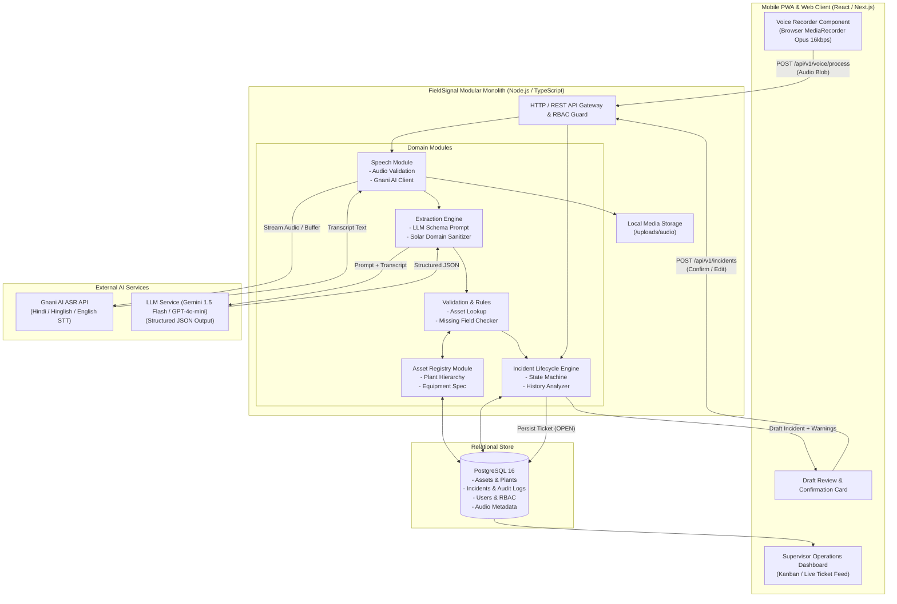
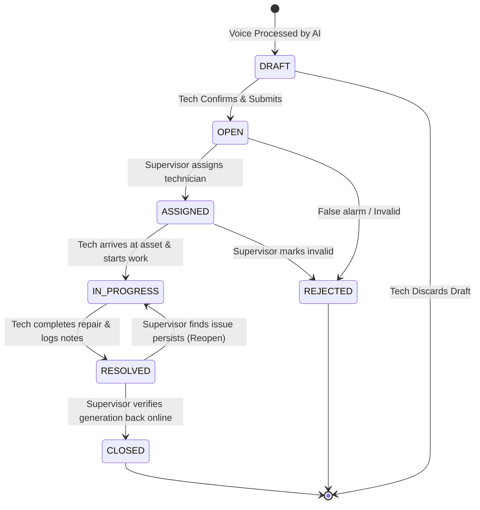

1. **YAGNI & Anti-Over-Engineering:** Zero microservices, zero Kubernetes, zero distributed message brokers (Kafka/RabbitMQ) for MVP.
2. **Unified Single-Process Monolith:** Frontend and backend live in one single codebase with shared TypeScript interfaces. All domain communication happens via in-process typed module calls.
3. **Native & Standard Platform Features First:**
   - Standard browser `MediaRecorder` API with native WebM/Opus compression.
   - PostgreSQL relational integrity with native Foreign Keys and JSONB for flexible telemetry.
   - Native Node.js background timers / Promise-based execution for asynchronous audio processing without an external Celery/Redis fleet.
4. **Deliberate Simplifications Matrix (Ponytail Ceiling Registry):**

| Component | MVP Pragmatic Choice | Known Ceiling | Clear Upgrade Path |
| :--- | :--- | :--- | :--- |
| **Message Queue / Workers** | In-process asynchronous task queue (`p-queue` or Node event loop) | Max ~50 concurrent audio transcriptions per single server instance | Offload to Redis + BullMQ or Celery worker dyno when scaling beyond 5 plants |
| **Audio File Storage** | Local filesystem volume (`/var/data/fieldsignal/audio`) behind signed static route | Single disk storage ceiling (~500GB); not replicated across multi-region | Drop-in S3 / Google Cloud Storage adapter via existing `StorageProvider` interface |
| **Search / History Lookup** | PostgreSQL indexes (`asset_id`, `created_at`) + `ILIKE` / `pg_trgm` | Large text search across >500,000 incident notes | Introduce Meilisearch or PostgreSQL tsvector full-text search |
| **Authentication** | Secure HttpOnly Cookie + HMAC JWT | Requires manual token revocation list if user is blocked immediately | Redis-backed session store or standard Ory Kratos / Supabase Auth |
| **Asset Hierarchy** | Adjacency List pattern (`parent_asset_id` on `assets` table) | Deep recursive tree queries beyond 4 levels (Plant → Block → Inverter → SMB) | PostgreSQL `ltree` extension or Nested Sets model |

---

## 2. System Architecture Diagram



---

## 3. Technology Stack Selection

- **Runtime & Language:** Node.js (v20+ LTS) with TypeScript 5.x.
- **Framework:** Next.js 14+ (App Router) or Fastify + React Vite.
  - *Recommendation:* **Next.js 14 Full-Stack TypeScript Monolith**.
  - *Rationale:* Eliminates backend/frontend repo synchronization issues, shares Zod schemas between client forms and API validators, and provides instant PWA support for mobile technicians.
- **Database:** **PostgreSQL 16**.
- **ORM / Query Builder:** **Prisma** or **Drizzle ORM** (Drizzle recommended for zero-overhead, ultra-fast cold starts and explicit SQL control).
- **Audio Capture:** HTML5 `navigator.mediaDevices.getUserMedia` with `MediaRecorder` encoding to `audio/webm;codecs=opus` at 16kbps CBR.
- **Speech-to-Text (ASR):** **Gnani AI ASR API** with language codes:
  - `hi-IN` (Hindi)
  - `en-IN` (Indian English)
  - Hinglish mixed code-switching profile.
- **AI Extraction Layer:** **Google Gemini 1.5 Flash** or **OpenAI GPT-4o-mini** with `response_format: { type: "json_object" }` constrained by Zod schema.
- **UI & Styling:** Tailwind CSS + Radix UI / Lucide Icons. High-contrast theme tailored for outdoor sunlight readability.

---

## 4. Module Boundaries & Directory Structure

```
FieldSignal/
├── docs/
│   ├── PRD.md
│   └── ARCHITECTURE.md
├── src/
│   ├── app/                      # Next.js App Router (UI Pages & API Routes)
│   │   ├── (auth)/login/
│   │   ├── (field)/report/       # Voice reporting PWA screen
│   │   ├── (field)/draft/[id]/   # Confirmation screen
│   │   ├── (dashboard)/incidents/# Supervisor operations view
│   │   ├── (dashboard)/assets/   # Plant equipment hierarchy view
│   │   └── api/v1/               # Public REST API Endpoints
│   │       ├── auth/
│   │       ├── voice/process/
│   │       ├── incidents/
│   │       └── assets/
│   ├── modules/                  # Isolated Modular Monolith Domains
│   │   ├── auth/                 # JWT verification, RBAC guard, Password hashing
│   │   ├── speech/               # Gnani AI integration & audio validation
│   │   ├── extraction/           # Prompt templates, LLM client, Schema sanitization
│   │   ├── assets/               # Plant hierarchy queries, fuzzy tag matching
│   │   ├── incidents/            # Lifecycle state machine, audit log, history lookup
│   │   └── storage/              # Local disk file system with signed URL generator
│   ├── lib/                      # Shared cross-cutting utilities
│   │   ├── db.ts                 # Database client singleton
│   │   ├── env.ts                # Validated environment variables (Zod)
│   │   └── logger.ts             # Structured JSON logger (Pino)
│   ├── types/                    # Shared domain models & DTOs
│   └── schemas/                  # Zod validation schemas for API & LLM
├── prisma/                       # Database schema & migrations
│   └── schema.prisma
├── public/                       # Static assets & PWA manifest
├── package.json
└── tsconfig.json
```

---

## 5. Database Schema & Data Models

### 5.1 Entity Relationship Overview
- A **Plant** contains multiple **Users** and **Assets**.
- An **Asset** belongs to a **Plant** and can reference a `parent_asset_id` (forming a 4-level tree: Plant → Block → Inverter Station / Substation → SMB / Tracker / Component).
- An **AudioRecord** belongs to a **User** and stores the original field recording metadata and raw Gnani transcript.
- An **Incident** belongs to an **Asset**, was reported by a **User**, is optionally assigned to a **User**, references an **AudioRecord**, and tracks its lifecycle.
- An **IncidentAuditLog** records every state transition, field edit, and timestamp for warranty and insurance compliance.

### 5.2 Prisma / SQL Schema Definition

```prisma
datasource db {
  provider = "postgresql"
  url      = env("DATABASE_URL")
}

generator client {
  provider = "prisma-client-js"
}

enum UserRole {
  FIELD_TECH
  SITE_SUPERVISOR
  PLANT_MANAGER
}

enum AssetType {
  CENTRAL_INVERTER
  STRING_INVERTER
  TRANSFORMER
  SMB_SCB              // String Monitoring Box / Combiner Box
  TRACKER_CONTROLLER
  TRACKER_MOTOR
  MODULE_STRING
  HT_PANEL_BREAKER
  WEATHER_STATION_WMS
  AUXILIARY_SYSTEM
}

enum AssetStatus {
  OPERATIONAL
  DEGRADED
  FAULTED
  UNDER_MAINTENANCE
  DECOMMISSIONED
}

enum IncidentStatus {
  DRAFT                 // Extracted by AI, waiting for technician review
  OPEN                  // Confirmed by technician, awaiting supervisor triage
  ASSIGNED              // Allocated to an engineer/technician for fix
  IN_PROGRESS           // Field repair currently underway
  RESOLVED              // Fixed in field, awaiting supervisor verification
  CLOSED                // Verified and archived
  REJECTED              // False alarm / duplicate
}

enum Priority {
  LOW
  MEDIUM
  HIGH
  CRITICAL              // Threat to safety, fire risk, or major generation loss (>1 MW)
}

enum FaultCategory {
  OVER_TEMPERATURE
  INSULATION_RESISTANCE
  EARTH_FAULT
  GRID_TRIP_ABNORMAL_VOLTAGE
  COMMUNICATION_LOSS_SCADA
  TRACKER_STUCK_MECHANICAL
  DC_ARC_OR_BURN
  STRING_UNDERPERFORMANCE
  FUSE_BLOWN
  SENSOR_DEFECT
  OTHER
}

model Plant {
  id           String      @id @default(uuid())
  code         String      @unique // e.g. "PLANT-RAJ-01"
  name         String      // e.g. "Bhadla Solar Park Block IV"
  capacityMw   Decimal     @db.Decimal(8, 2)
  state        String      // e.g. "Rajasthan"
  country      String      @default("India")
  timezone     String      @default("Asia/Kolkata")
  createdAt    DateTime    @default(now())
  updatedAt    DateTime    @updatedAt

  users        User[]
  assets       Asset[]
  incidents    Incident[]

  @@map("plants")
}

model User {
  id           String      @id @default(uuid())
  plantId      String
  name         String
  phone        String      @unique
  email        String?     @unique
  passwordHash String
  role         UserRole    @default(FIELD_TECH)
  isActive     Boolean     @default(true)
  createdAt    DateTime    @default(now())
  updatedAt    DateTime    @updatedAt

  plant        Plant       @relation(fields: [plantId], references: [id], onDelete: Restrict)
  reportedIncidents Incident[] @relation("ReportedBy")
  assignedIncidents Incident[] @relation("AssignedTo")
  audioRecords      AudioRecord[]
  auditLogs         IncidentAuditLog[]

  @@index([plantId, role])
  @@map("users")
}

model Asset {
  id              String       @id @default(uuid())
  plantId         String
  parentAssetId   String?
  assetTag        String       // e.g. "INV-04", "SMB-02-B", "TR-01"
  name            String       // e.g. "Central Inverter 4 (SMA 2.5MW)"
  assetType       AssetType
  blockIdentifier String       // e.g. "Block-02", "Inverter Station 04"
  status          AssetStatus  @default(OPERATIONAL)
  manufacturer    String?
  model           String?
  serialNumber    String?
  commissionDate  DateTime?
  metadata        Json?        // Technical specs, rated DC voltage, string count
  createdAt       DateTime     @default(now())
  updatedAt       DateTime     @updatedAt

  plant           Plant        @relation(fields: [plantId], references: [id], onDelete: Restrict)
  parentAsset     Asset?       @relation("AssetHierarchy", fields: [parentAssetId], references: [id])
  childAssets     Asset[]      @relation("AssetHierarchy")
  incidents       Incident[]

  @@unique([plantId, assetTag, blockIdentifier])
  @@index([plantId, assetType])
  @@index([assetTag])
  @@map("assets")
}

model AudioRecord {
  id               String       @id @default(uuid())
  plantId          String
  userId           String
  filePath         String       // Relative storage path: "/uploads/audio/2026/11/abc.webm"
  fileSizeBytes    Int
  mimeType         String       @default("audio/webm")
  durationSeconds  Float
  rawTranscript    String?      @db.Text
  detectedLanguage String?      // "hi-IN", "en-IN", "hinglish"
  gnaniConfidence  Float?
  gnaniLatencyMs   Int?
  llmLatencyMs     Int?
  createdAt        DateTime     @default(now())

  user             User         @relation(fields: [userId], references: [id], onDelete: Restrict)
  incident         Incident?

  @@index([userId, createdAt])
  @@map("audio_records")
}

model Incident {
  id                   String          @id @default(uuid())
  ticketNumber         String          @unique // e.g. "FS-2026-00421"
  plantId              String
  assetId              String?
  reportedByUserId     String
  assignedToUserId     String?
  audioRecordId        String?         @unique

  status               IncidentStatus  @default(OPEN)
  priority             Priority        @default(MEDIUM)
  faultCategory        FaultCategory   @default(OTHER)
  errorCode            String?         // e.g. "E-23", "F-042", "ERR_INSUL"
  
  title                String          // Short AI or user summarized title
  description          String          @db.Text // Full detail description
  symptoms             String?         @db.Text // Observed symptoms
  immediateActionTaken String?         @db.Text // e.g. "DC Breaker trip kiya gaya"
  
  // Intelligence & Validation Data
  missingFields        Json?           // e.g. ["error_code", "inverter_block"]
  isRepeatFault        Boolean         @default(false)
  repeatCount30d       Int             @default(0)
  
  confirmedAt          DateTime?
  resolvedAt           DateTime?
  closedAt             DateTime?
  resolutionNotes      String?         @db.Text

  createdAt            DateTime        @default(now())
  updatedAt            DateTime        @updatedAt

  plant                Plant           @relation(fields: [plantId], references: [id], onDelete: Restrict)
  asset                Asset?          @relation(fields: [assetId], references: [id], onDelete: SetNull)
  reportedBy           User            @relation("ReportedBy", fields: [reportedByUserId], references: [id], onDelete: Restrict)
  assignedTo           User?           @relation("AssignedTo", fields: [assignedToUserId], references: [id], onDelete: SetNull)
  audioRecord          AudioRecord?    @relation(fields: [audioRecordId], references: [id], onDelete: SetNull)
  auditLogs            IncidentAuditLog[]

  @@index([plantId, status])
  @@index([assetId, createdAt])
  @@index([priority, status])
  @@map("incidents")
}

model IncidentAuditLog {
  id           String          @id @default(uuid())
  incidentId   String
  userId       String
  action       String          // "STATUS_CHANGE", "ASSIGNMENT", "FIELD_EDIT", "CONFIRM"
  fromStatus   IncidentStatus?
  toStatus     IncidentStatus?
  payloadDiff  Json?           // JSON patch of changed fields
  note         String?
  createdAt    DateTime        @default(now())

  incident     Incident        @relation(fields: [incidentId], references: [id], onDelete: Cascade)
  user         User            @relation(fields: [userId], references: [id], onDelete: Restrict)

  @@index([incidentId, createdAt])
  @@map("incident_audit_logs")
}
```

---

## 6. End-to-End API Contracts

### 6.1 Authentication
#### `POST /api/v1/auth/login`
- **Request Body:**
```json
{
  "phone": "+919876543210",
  "password": "techSecurePassword123"
}
```
- **Response `200 OK`:** Sets `HttpOnly; Secure; SameSite=Lax` session cookie `fs_session`.
```json
{
  "success": true,
  "user": {
    "id": "usr-10294",
    "name": "Karan Sharma",
    "role": "FIELD_TECH",
    "plantId": "plt-bhadla-04",
    "plantName": "Bhadla Solar Park Block IV"
  }
}
```

---

### 6.2 Voice Processing Pipeline
#### `POST /api/v1/voice/process`
- **Content-Type:** `multipart/form-data`
- **Payload:**
  - `audio`: File (audio/webm, max 5MB, duration 5–60s)
  - `blockHint`: Optional string (e.g. "Block 2")
- **Internal Pipeline Operations:**
  1. Validate audio length, MIME type, and size.
  2. Write audio buffer to local storage volume: `/uploads/audio/{YYYY}/{MM}/{UUID}.webm`.
  3. Send stream to **Gnani AI ASR** (`hi-IN` / `en-IN` Hinglish speech-to-text).
  4. Send raw transcript to **LLM Structured Extractor** with solar taxonomy.
  5. Run **Validation Engine**: query `assets` table for matching equipment in technician's plant.
  6. Run **History Engine**: count incidents on matched asset in past 30 days.
  7. Construct and return **Draft Incident Object** (NOT yet written to `incidents` table).
- **Response `200 OK`:**
```json
{
  "draftId": "drf-948f-39d2",
  "audioRecordId": "aud-8492-4921",
  "audioUrl": "/api/v1/audio/aud-8492-4921.webm",
  "transcript": {
    "rawText": "Bhai Block 2 me Inverter 5 subah se E-14 over-temperature error de raha hai. Heat sink bahut garam hai aur fan nahi chal raha.",
    "detectedLanguage": "hi-IN",
    "confidence": 0.94
  },
  "extraction": {
    "assetTag": "INV-05",
    "blockIdentifier": "Block 2",
    "faultCategory": "OVER_TEMPERATURE",
    "errorCode": "E-14",
    "severity": "HIGH",
    "title": "Inverter 5 E-14 Over-Temperature Trip",
    "symptoms": "Heat sink overheating, cooling fan not operating",
    "immediateActionTaken": "None reported"
  },
  "validation": {
    "matchedAsset": {
      "id": "ast-inv-05-b2",
      "assetTag": "INV-05",
      "name": "Central Inverter 5 (ABB PVS980 2MW)",
      "block": "Block 2",
      "status": "OPERATIONAL"
    },
    "isAssetAmbiguous": false,
    "missingFields": [],
    "technicianPrompt": null
  },
  "assetHistory": {
    "hasRecentIncidents": true,
    "repeatCount30d": 2,
    "lastIncident": {
      "ticketNumber": "FS-2026-00388",
      "faultCategory": "OVER_TEMPERATURE",
      "reportedAt": "2026-11-01T14:22:00Z",
      "status": "RESOLVED",
      "resolutionNotes": "Blower fan dust cleaned, restarted."
    },
    "warningMessage": "Repeat Fault: 2nd over-temperature trip in 48 hours. Consider blower motor replacement."
  }
}
```

- **Example Response When Required Fields are Missing (e.g. Asset ambiguous or missing error code):**
```json
{
  "draftId": "drf-3829-1120",
  "audioRecordId": "aud-3321-9941",
  "transcript": {
    "rawText": "Inverter trip ho gaya hai dhuan nikal raha tha",
    "detectedLanguage": "hi-IN",
    "confidence": 0.88
  },
  "extraction": {
    "assetTag": null,
    "blockIdentifier": null,
    "faultCategory": "DC_ARC_OR_BURN",
    "errorCode": null,
    "severity": "CRITICAL",
    "title": "Inverter smoke detected / trip",
    "symptoms": "Smoke emitting, inverter tripped"
  },
  "validation": {
    "matchedAsset": null,
    "isAssetAmbiguous": true,
    "missingFields": ["assetTag", "blockIdentifier", "errorCode"],
    "technicianPrompt": "Aapne Inverter ka number aur Block nahi bataya. Kripya niche se sahi Inverter select karein."
  },
  "assetHistory": {
    "hasRecentIncidents": false,
    "repeatCount30d": 0,
    "lastIncident": null,
    "warningMessage": null
  }
}
```

---

### 6.3 Incident Management
#### `POST /api/v1/incidents` (Confirm Draft & Create Incident)
- **Role Required:** `FIELD_TECH`, `SITE_SUPERVISOR`, `PLANT_MANAGER`
- **Request Body:**
```json
{
  "audioRecordId": "aud-8492-4921",
  "assetId": "ast-inv-05-b2",
  "title": "Inverter 5 E-14 Over-Temperature Trip",
  "description": "Technician reported Inverter 5 in Block 2 tripping on E-14 over-temp. Heat sink extremely hot, fan failure.",
  "symptoms": "Heat sink overheating, cooling fan stopped",
  "faultCategory": "OVER_TEMPERATURE",
  "errorCode": "E-14",
  "priority": "HIGH",
  "immediateActionTaken": "Isolated DC switch"
}
```
- **Response `201 Created`:**
```json
{
  "success": true,
  "incident": {
    "id": "inc-4920-4102",
    "ticketNumber": "FS-2026-00422",
    "status": "OPEN",
    "priority": "HIGH",
    "assetTag": "INV-05",
    "block": "Block 2",
    "reportedBy": "Karan Sharma",
    "isRepeatFault": true,
    "createdAt": "2026-11-03T12:35:00Z"
  }
}
```

#### `GET /api/v1/incidents` (List Incidents)
- **Query Parameters:**
  - `status`: Optional filter (`OPEN`, `ASSIGNED`, `IN_PROGRESS`, `RESOLVED`, `CLOSED`)
  - `priority`: Optional filter (`LOW`, `MEDIUM`, `HIGH`, `CRITICAL`)
  - `block`: Optional string
  - `assetType`: Optional enum
  - `page`: default 1
  - `limit`: default 20
- **Response `200 OK`:**
```json
{
  "data": [
    {
      "id": "inc-4920-4102",
      "ticketNumber": "FS-2026-00422",
      "title": "Inverter 5 E-14 Over-Temperature Trip",
      "status": "OPEN",
      "priority": "HIGH",
      "faultCategory": "OVER_TEMPERATURE",
      "asset": {
        "id": "ast-inv-05-b2",
        "assetTag": "INV-05",
        "block": "Block 2",
        "assetType": "CENTRAL_INVERTER"
      },
      "reportedBy": {
        "id": "usr-10294",
        "name": "Karan Sharma"
      },
      "assignedTo": null,
      "isRepeatFault": true,
      "hasAudio": true,
      "createdAt": "2026-11-03T12:35:00Z"
    }
  ],
  "pagination": {
    "page": 1,
    "limit": 20,
    "totalCount": 42,
    "totalPages": 3
  }
}
```

#### `PATCH /api/v1/incidents/:id/status` (Update Lifecycle State)
- **Request Body:**
```json
{
  "status": "ASSIGNED",
  "assignedToUserId": "usr-8841-3312",
  "note": "Assigned to electrical team lead Rahul for fan motor inspection"
}
```
- **Response `200 OK`:**
```json
{
  "success": true,
  "incidentId": "inc-4920-4102",
  "previousStatus": "OPEN",
  "currentStatus": "ASSIGNED",
  "assignedTo": "Rahul Verma",
  "updatedAt": "2026-11-03T12:40:00Z"
}
```

---

### 6.4 Asset Intelligence
#### `GET /api/v1/assets/search?q=INV-05`
- Returns fuzzy/autocomplete matches within the active plant for instant mobile selection.
```json
{
  "results": [
    {
      "id": "ast-inv-05-b2",
      "assetTag": "INV-05",
      "name": "Central Inverter 5",
      "block": "Block 2",
      "type": "CENTRAL_INVERTER",
      "status": "OPERATIONAL"
    }
  ]
}
```

#### `GET /api/v1/assets/:id/history`
- Returns chronological list of all incidents recorded on this equipment tag.

---

## 7. Incident Lifecycle State Machine



### Transition Matrix & Permissions

| Current State | Target State | Permitted Roles | Required Action / Payload |
| :--- | :--- | :--- | :--- |
| **`DRAFT`** | `OPEN` | `FIELD_TECH`, `SITE_SUPERVISOR` | Confirm fields, asset selection, submit. |
| **`DRAFT`** | Discarded | `FIELD_TECH` | Cancel draft without DB ticket creation. |
| **`OPEN`** | `ASSIGNED` | `SITE_SUPERVISOR`, `PLANT_MANAGER` | Select `assignedToUserId`. |
| **`OPEN`** | `REJECTED` | `SITE_SUPERVISOR`, `PLANT_MANAGER` | Rejection reason note. |
| **`ASSIGNED`** | `IN_PROGRESS` | `FIELD_TECH` (Assigned), `SITE_SUPERVISOR` | Tech acknowledges work commenced. |
| **`IN_PROGRESS`** | `RESOLVED` | `FIELD_TECH` (Assigned), `SITE_SUPERVISOR` | Mandatory `resolutionNotes` + parts replaced. |
| **`RESOLVED`** | `CLOSED` | `SITE_SUPERVISOR`, `PLANT_MANAGER` | Verification note (SCADA power restored). |
| **`RESOLVED`** | `IN_PROGRESS` | `SITE_SUPERVISOR`, `PLANT_MANAGER` | Reopen note if fault recurs immediately. |

---

## 8. Failure Modes, Security Risks & Mitigations

### 8.1 Audio & Acoustic Failures in Solar Fields
- **Risk:** Central inverter cooling fans produce continuous 70–85 dB high-frequency whine; high desert wind causes microphone clipping.
- **Mitigation:**
  1. Frontend Web Audio API applies high-pass filter (cutoff 120Hz) to suppress wind buffeting before encoding.
  2. Gnani AI custom acoustic model calibrated for industrial background noise.
  3. If Gnani confidence score is < 0.60, UI alerts: *"High background noise detected. Please step 5 meters away from the inverter fan and re-record."*

### 8.2 Network Drops in Remote Solar Sites
- **Risk:** Remote plants in Thar Desert (Bhadla) or Khavda have spotty 2G/EDGE cellular data. HTTP upload fails mid-transit.
- **Mitigation:**
  1. Client-side IndexedDB queue stores recorded audio blobs locally with status `QUEUED_OFFLINE`.
  2. Service Worker listens for `online` window event and automatically attempts retry with exponential backoff.
  3. UI displays a persistent badge: *"1 recording pending upload (waiting for network)"*.

### 8.3 Gnani AI or LLM Downtime / Latency Spikes
- **Risk:** Third-party API timeout blocks the technician in the field.
- **Mitigation:**
  1. Strict 6-second timeout on Gnani ASR and 5-second timeout on LLM extraction.
  2. **Graceful Fallback:** If AI service fails, the system immediately returns a standard draft with the audio recording attached and generic fallback fields: *"Manual Input Needed (Speech Engine Busy)"*.
  3. Technician can manually type or pick the asset from dropdown without losing their voice file.

### 8.4 LLM Hallucinations & Asset Misattributions
- **Risk:** LLM guesses non-existent inverter or changes "Inverter 12" to "Inverter 2".
- **Mitigation:**
  1. **Zero Unvalidated Write Rule:** LLM extraction is *never* written directly to the `incidents` table. It produces an ephemeral `Draft` shown to the human technician.
  2. **Asset Registry Foreign Key Constraint:** `assetId` must resolve to an existing ID in `assets`.
  3. Confirmation screen highlights extracted values in bold chips with single-tap dropdown edit.

### 8.5 Security & Data Isolation
- **Tenant Isolation:** Every query strictly scopes by `plantId` derived from the validated JWT session, preventing cross-plant leakage.
- **Audio File Privacy:** Audio URLs are served through an authenticated proxy route (`/api/v1/audio/:id`) that validates the user's plant membership before streaming.
- **Input Sanitization:** All text inputs sanitized against SQL injection (via Prisma prepared statements) and XSS (via React DOM escaping).

---

## 9. Ponytail Implementation Plan (Solo Developer)

To execute this entire platform in 4 weeks as a solo developer, development is broken into 4 clean sequential phases:

### Phase 1: Core Foundation & Asset Registry (Week 1)
- Setup Next.js 14 TypeScript project with Tailwind CSS and PostgreSQL (via Docker or local).
- Initialize Prisma schema (`plants`, `users`, `assets`, `incidents`, `audio_records`, `audit_logs`).
- Seed script for realistic 50MW Solar Plant (Bhadla Solar Park: 25 Inverter Stations, 100 SMBs).
- Session authentication with roles (`FIELD_TECH`, `SITE_SUPERVISOR`).

### Phase 2: Speech & AI Extraction Pipeline (Week 2)
- Mobile PWA voice recorder with HTML5 `MediaRecorder` (Opus 16kbps).
- Audio storage service (local volume).
- Gnani AI ASR integration client (`/api/v1/voice/process`).
- LLM structured extraction service with strict solar O&M prompt and Zod schema validation.

### Phase 3: Validation Engine, Asset History & Confirmation Flow (Week 3)
- Asset matching algorithm (exact tag match + block disambiguation).
- Missing fields rule engine.
- 30-day asset incident history lookup.
- Mobile Draft Confirmation screen with interactive fields, repeat fault warning, and confirmation submission.

### Phase 4: Supervisor Operations Dashboard & Ticket Lifecycle (Week 4)
- Responsive Kanban board / live table for Site Supervisors.
- Status transition modals with audit log tracking.
- Audio playback widget on incident details page.
- Polish outdoor high-contrast UI theme and offline audio caching.
