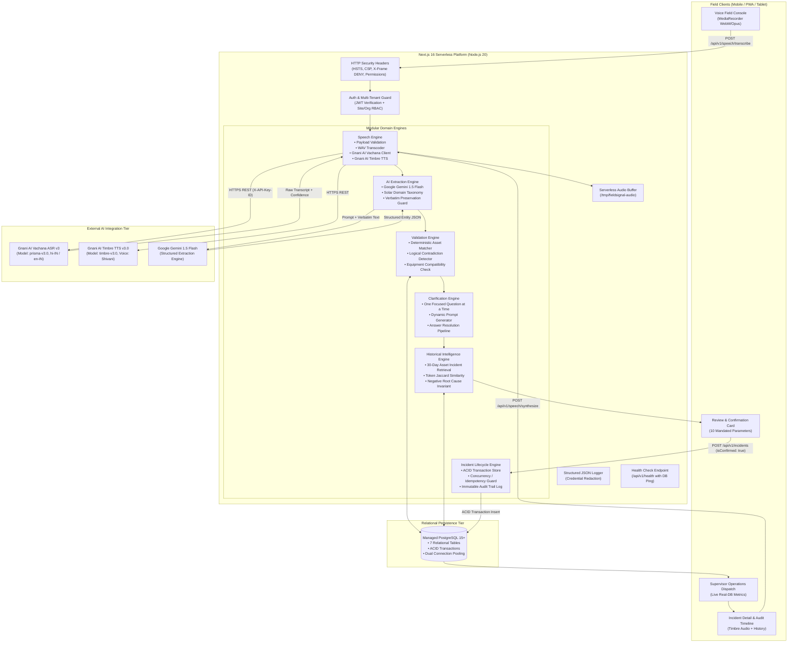

# FieldSignal — Production Architecture Specification

**Document Version:** 2.0.0 (Production / Competition Ready)  
**System Classification:** Voice-First Industrial Monolith  
**Target Domain:** Utility-Scale Solar PV Operations & Maintenance (O&M)  

---

## 1. Architectural Philosophy & Principles

FieldSignal is engineered as a resilient, domain-driven modular monolith:

1. **Pragmatic Monolith (Zero Distributed Overhead):** Single codebase combining Next.js App Router server components, typed API route handlers, and domain modules. Eliminates microservice boundary serialization, network hops, and multi-repo drift.
2. **Standard Platform Capabilities First:** Uses native Web Audio APIs in the browser, native PostgreSQL relational constraints with ACID transactions, standard Node.js crypto/streams, and zero unnecessary dependencies.
3. **Defense-in-Depth & Tenant Isolation:** Every request enforces cryptographic JWT validation and strictly scopes database operations to the user's `organizationId` and assigned `siteId`.
4. **Verbatim Auditability:** Original voice transcripts and raw recording metadata are preserved in permanent immutable database columns, completely separate from AI-extracted fields or technician edits.
5. **Human-in-the-Loop Safety:** AI output is treated strictly as an uncommitted draft. Mandatory human confirmation is enforced by the database before ticket issuance.

### Pragmatic Ceilings & Explicit Upgrade Paths (Ponytail Architecture)

| Component | Current Implementation | System Ceiling | Upgrade Path |
| :--- | :--- | :--- | :--- |
| **Audio Storage** | Ephemeral serverless `/tmp` staging with disk persistence (`src/lib/audio-storage.ts`) | Single container lifecycle on Vercel/Lambda | Attach AWS S3 / Google Cloud Storage bucket or Vercel Blob token |
| **Connection Pooling** | Prisma Client with dual `DATABASE_URL` (pooled) and `DIRECT_URL` (direct) | ~10,000 concurrent serverless connections via PgBouncer | Managed connection pooler (Neon Serverless Pooler / AWS RDS Proxy) |
| **Search & Triage** | Multi-column database queries (`ticketNumber`, `assetTag`, `status`, `priority`) with B-tree indices | Large dataset search across >500,000 incident notes | Add PostgreSQL `tsvector` or Meilisearch |
| **Logging** | Zero-dependency structured JSON logger (`src/lib/logger.ts`) with automated credential redaction | Writes structured JSON lines to stdout/stderr | Drain Vercel logs to Datadog / OpenTelemetry collector |
| **Offline Resilience** | Browser memory/session queue and quick audio fallback chips | Full offline sync engine | Progressive Web App (PWA) ServiceWorker + client SQLite/OPFS |

---

## 2. End-to-End System Topology



---

## 3. Subsystem Architecture

### 3.1 Speech Processing Subsystem (`src/modules/speech`)
1. **Client Audio Recording**: Captures audio via browser `MediaRecorder` using standard Opus/WebM format.
2. **Payload Validation** (`audio-validator.ts`): Rejects empty payloads, enforces a 10MB maximum limit, verifies acceptable MIME types (`audio/webm`, `audio/wav`, `audio/ogg`, `audio/mp4`).
3. **WAV Transcoding** (`audio-transcoder.ts`): If native container conversion is required, leverages `ffmpeg` (or passes standard PCM WAV).
4. **Serverless Storage** (`src/lib/audio-storage.ts`): Auto-detects serverless runtimes (`process.env.VERCEL`) and writes audio to `os.tmpdir()` (`/tmp/fieldsignal-audio`) to avoid `EROFS` read-only errors.
5. **Gnani AI Vachana ASR Client** (`gnani-speech-service.ts`): Transcribes audio via `https://api.vachana.ai/stt/v3` with the `prisma-v3.0` multilingual model. Supports Hinglish code-switching with custom solar domain vocabulary boost.
6. **Gnani AI Timbre TTS Client** (`gnani-tts-service.ts`): Synthesizes audio responses via `https://api.vachana.ai/api/v1/tts/inference` using `timbre-v3.0`. Timbre is strictly optional—if synthesis fails, the UI renders visible text.

### 3.2 AI Extraction & Validation Subsystem (`src/modules/extraction` & `src/modules/incidents`)
1. **Extraction Engine** (`gemini-extractor.ts`): Passes the speech transcript to Google Gemini 1.5 Flash using a strict JSON Schema prompt tuned for solar PV equipment.
2. **Verbatim Preservation Guard** (`ai-guard.ts`): Asserts that the original speech text is permanently retained without modification.
3. **Deterministic Asset Matcher** (`src/modules/assets/asset-matcher.ts`):
   - Searches active database equipment scoped to the technician's site.
   - Evaluates exact tags (`INV-01`), space-normalized tags (`inv 01`), and asset model names.
   - Flags cross-site references (`SITE_MISMATCH`) and ambiguous references (`AMBIGUOUS_MATCH`).
   - Rejects non-existent equipment (`NO_MATCH`) without guessing.
4. **Logical Contradiction Validator** (`incident-validator.ts`):
   - Prevents equipment-type mismatches (e.g. `TRACKER_FAILURE` assigned to a static `INVERTER`).
   - Prevents severity contradictions (e.g. fire/smoke hazard classified as `LOW` priority).
   - Validates that closed/resolved tickets have resolution notes.

### 3.3 Multi-Turn Clarification Subsystem (`src/modules/incidents`)
1. **Focused Question Engine** (`incident-clarification-service.ts`):
   - Generates **one focused question at a time** targeting the highest-priority missing field (`asset` → `current_status` → `alarm_code` → `repair_result`).
   - Avoids asking questions for data that is already known.
   - Once answered, dynamically updates the extracted draft without repeating previous questions.
2. **Ticket Clarification Pipeline** (`POST /api/v1/incidents/:id/clarifications`):
   - Allows supervisors or technicians to resolve clarification questions on active tickets.
   - Records answering technician identity, updates the incident, logs a timeline event, and transitions the status out of `NEEDS_CLARIFICATION`.

### 3.4 Historical Incident Intelligence Subsystem (`src/modules/incidents`)
1. **Deterministic Asset Query**: Queries active PostgreSQL records for the asset over the preceding 30 days.
2. **Token Jaccard Symptom Similarity**:
   - Tokenizes symptoms, removes Hindi/English stop words, and computes Jaccard overlap:
     $$\text{Similarity}(A, B) = \frac{|A \cap B|}{|A \cup B|}$$
   - Correlates error codes and thermal keywords.
3. **Strict Negative Invariant**:
   - **Never claims identical root cause merely due to description similarity.**
   - Prominently displays safety disclaimers: *"Description similarity does not establish identical root cause; electrical verification is required."*
4. **Standard Classifications**: Labels each historical record as:
   - `Same asset`
   - `Similar reported symptom`
   - `Previous incident`
   - `Unresolved incident`

### 3.5 Technician Review & Confirmation Subsystem
Before ticket creation, the UI renders the **10 Mandated Parameters**:
1. Selected Site
2. Selected Asset
3. Original Transcript
4. Fault Description
5. Reported Alarm Code
6. Observed Symptoms
7. Actions Already Taken
8. Suggested Priority
9. Missing Information Flags
10. Historical Context & Repeat Fault Alerts

Technicians can edit fields inline. Explicit confirmation (`isConfirmed: true`) is required before submission. Submissions are protected by a 15-minute idempotency window to prevent duplicate tickets on connection retries.

### 3.6 Supervisor Operations Dispatch Subsystem
1. **Live Database Calculations**: All KPIs (Open Incidents, Awaiting Review, Critical/High Severity, Inverters Offline) are computed from live PostgreSQL queries.
2. **Crew Workload Roster**: Displays real on-duty technicians with active assigned workloads.
3. **Recurring Asset Reports**: Aggregates assets with 2+ incidents in 30 days.
4. **Interactive Triage**: Real-time technician assignment, priority overrides, and status transitions (`SUBMITTED` → `ACKNOWLEDGED` → `IN_PROGRESS` → `RESOLVED` → `CLOSED`).

---

## 4. Database Schema & Relational Integrity

The relational model is declared in [`prisma/schema.prisma`](file:///home/karan/Desktop/FieldSignal/prisma/schema.prisma):

```
┌────────────────────────┐         1:N         ┌────────────────────────┐
│      Organization      ├────────────────────►│          Site          │
└───────────┬────────────┘                     └───────────┬────────────┘
            │ 1:N                                          │ 1:N
            ▼                                              ▼
┌────────────────────────┐                     ┌────────────────────────┐
│          User          │                     │         Asset          │
└───────────┬────────────┘                     └───────────┬────────────┘
            │                                              │
            │ 1:N (Reported/Assigned)                      │ 1:N
            ▼                                              ▼
┌───────────────────────────────────────────────────────────────────────┐
│                               Incident                                │
│   • id (UUID)                      • originalTranscript (Immutable)   │
│   • ticketNumber (INC-2026-XXXX)   • status / priority                │
│   • isRepeatFault / repeatCount30d • confirmedAt / resolvedAt         │
└───────────────────┬───────────────────────────────────┬───────────────┘
                    │ 1:N                               │ 1:N
                    ▼                                   ▼
┌───────────────────────────────────────┐   ┌───────────────────────────┐
│             IncidentEvent             │   │       Clarification       │
│   • eventType (CONFIRMATION, STATUS)  │   │   • question / response   │
│   • userId / diff (JSONB)             │   │   • status / missingField │
└───────────────────────────────────────┘   └───────────────────────────┘
```

---

## 5. Security & Isolation Architecture

1. **HTTP Security Headers**: HSTS (`max-age=63072000`), `X-Frame-Options: DENY`, `X-Content-Type-Options: nosniff`, and `Permissions-Policy: camera=(), microphone=(self)`.
2. **Zero Client Secrets**: No `NEXT_PUBLIC_*` tokens for databases, speech models, or LLMs. All third-party credentials run on the server.
3. **Automated Credential Redaction**: The production logger (`src/lib/logger.ts`) strips tokens, passwords, cookies, and authorization headers from logs.
4. **Multi-Tenant Site Isolation**: Users cannot query or mutate assets or tickets belonging to other organizations or sites where they lack permissions.
